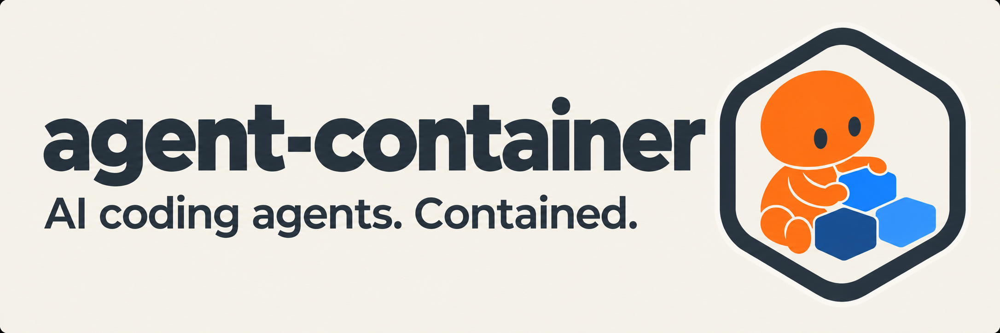

# agent-container



A Debian 13 workspace for Codex CLI, OpenCode v2, and T3 Code nightly, with a web
configuration dashboard and persistent agent sessions and project files. Run it
on existing hardware; optionally use Sysbox on Linux for Docker-based builds
and integration tests without mounting the host Docker socket.

## Quick start

Requires Docker with Compose and Linux container support (`amd64` or `arm64`).
Use the [published images](docs/images.md) to skip local builds.
From the repository root:

```sh
cp .env.example .env
docker compose up -d --build --wait
docker compose exec --user agent workspace t3-pair
```

Open the printed pairing URL for T3 Code (default: `localhost:3773`). Open the
configuration dashboard at <http://localhost:3780> and get its password with:

```sh
docker compose exec dashboard cat /var/lib/agent-dashboard/password
```

Both ports bind to loopback by default. Next, [log in to your providers](docs/getting-started.md#configure-the-agents).
For nested Docker, follow the [Sysbox setup](docs/sysbox.md); the base stack
starts without an internal Docker daemon.

## Documentation

- [Getting started](docs/getting-started.md): pairing, shell access, provider login.
- [Docker-in-Docker with Sysbox](docs/sysbox.md): Linux setup and nested workloads.
- [Configuration dashboard](docs/dashboard.md): instructions, settings, backups.
- [Remote access](docs/remote-access.md): web/native clients, HTTPS, T3 Connect.
- [Persistent storage](docs/storage.md) and [updates](docs/updates.md).
- [All guides](docs/README.md): GitHub, Context7, development, validation.

Saved state survives recreation. **`docker compose down -v` deletes the volumes.**
Sysbox shares the host kernel; see [isolation limits](docs/architecture.md#isolation-and-practical-limits).
